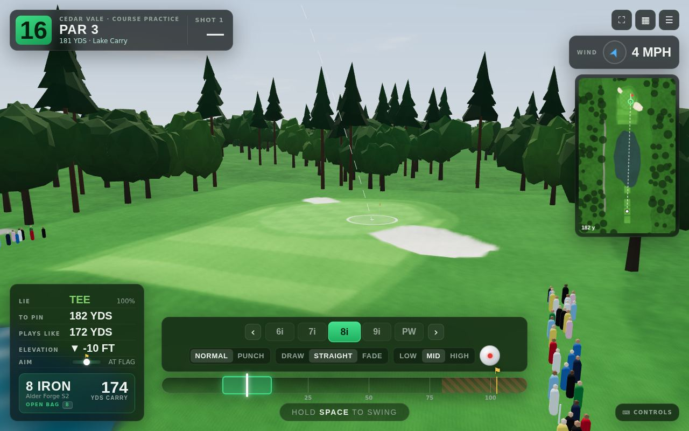
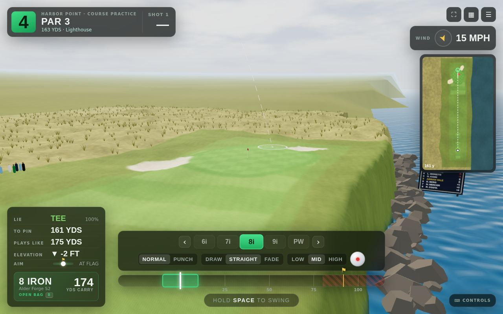
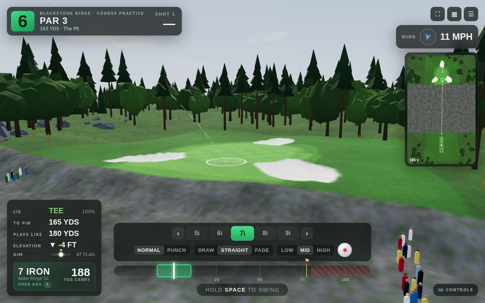
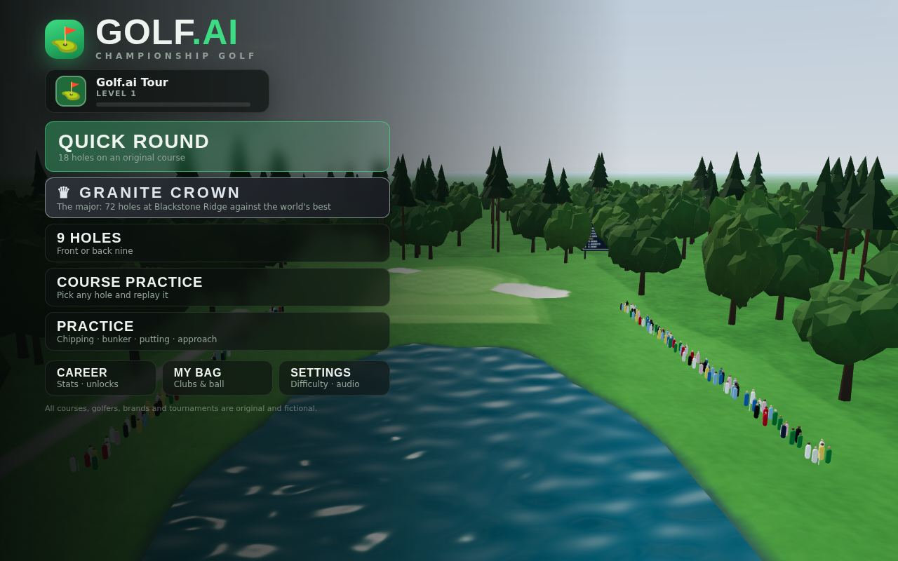

# Golf.ai Championship

A 3D golf game that runs in the browser. Pick a golfer, grab your clubs, choose a course and play a full round.



| | |
| --- | --- |
|  |  |



> All courses, golfers, equipment brands and tournaments are original and fictional. None of them reproduces a real course, player, brand or event.

## Play it

**Put it online for your iPhone:** see [DEPLOY.md](DEPLOY.md). Connect the repo to Netlify once and every push updates the live game.


The game ships prebuilt in `dist/game.js`, so there's nothing to install.

- **Easiest:** open `game/index.html` in Chrome, Edge, Firefox or Safari.
- **Local server:** some browsers restrict `file://` pages. If yours does, run this and open http://localhost:8080:
  ```bash
  cd game
  python3 -m http.server 8080
  ```

You need a WebGL-capable browser. Progress saves automatically in the browser's local storage.

### Develop

```bash
cd game
npm install
npm run dev        # rebuilds on change, serves on http://localhost:8080
npm run build      # production bundle -> dist/game.js
npm run test:holes # generates all 180 holes and sanity-checks tees/greens
npm run test:physics
```

## How to play

| Control | Action |
| --- | --- |
| **Hold Space** | Backswing: the power meter fills. Past 100% you overswing, which gives more distance but a smaller sweet spot. |
| **Release Space** | Starts the downswing. The marker races back toward the green sweet spot. |
| **Tap Space** | Strike. A tap in the green zone is a pure hit. Early pulls or hooks; late pushes or slices. Missing badly costs distance. |
| ← / → | Aim. Hold to accelerate. You can also click the minimap to aim. |
| ↑ / ↓ | Change club. On the green, this changes the putt length scale instead. |
| B, or click / tap the club card | Open your bag. The camera rises to a bird's-eye view of the hole, with distance arcs and each club's carry. ← / → browse, Enter opens the club card and Enter again selects the club, Esc closes. |
| X | Shot type: Normal, Punch, Chip, Pitch, Lob, Flop or Bunker. Which ones are available depends on your lie. |
| Q / E | Draw / fade |
| T | Trajectory: low, mid or high |
| I J K L, or click the ball icon | Strike point. Hitting the top of the ball adds topspin, the bottom adds backspin, the sides add sidespin. |
| R | Aim straight at the pin |
| C / M | Cycle camera (shot, player, overhead map, green) / toggle the overhead map |
| Mouse drag / wheel | Look around / scout ahead along your aim line |
| G | Toggle the putting guide (break line and slope arrows) |
| Tab / Esc | Scorecard / pause menu |
| Space or Enter during flight | Fast-forward |

Putting uses a single press: hold to set power and release to stroke. The game solves the true line and pace for every putt. The dotted line on the green shows the real roll and turns green when you're aimed on the read. Release inside the gold band on the meter while on line and the putt always drops. Wind never affects a putt. On Realistic there is no band and only a short line.

## Features

- **3 original courses, all free to play from the start:**
  - **Cedar Vale Municipal** (CRS-01, easy): public parkland with broad fairways, old oaks, a creek and a lake-carry par 3.
  - **Harbor Point Links** (CRS-02, medium): windswept seaside links with dunes, fescue, pot bunkers and clifftop par 3s.
  - **Blackstone Ridge** (CRS-08, expert): championship course in an old granite quarry with rock ravines, deep bunkers and fast greens.
- **Tees:** Championship, Tournament, Member and Forward.
- **Ball physics:** drag and Magnus lift from real ball speed, launch and spin, plus wind that strengthens with height. Balls bounce off sloped terrain and bite or roll out based on spin and surface. Rolling responds to green speed, slope, lie, firmness, water, sand, trees (leaves and trunks), the flagstick and lip-outs.
- **Golf bag:** 19 club types from fictional brands: Vortex Golf (drivers, woods, hybrids), Alder Forge (irons, wedges), Northline (putters) and AeroPeak (balls). Each club has its own carry, launch, spin, accuracy and forgiveness. You build your own 14-club bag and choose your ball.
- **Club selection:** tap the club in hand to open the bag. The camera rises smoothly into a bird's-eye tactical view that shows:
  - the hole's fairway, rough, bunkers, water and trees
  - your position, the flag and your aim line
  - 50-yard distance arcs, plus the carry arc and dispersion of the club you're looking at

  The bag is a swipeable carousel. Tapping a club opens an animated card with:
  - a rotating 3D model of the club head that you can drag to inspect
  - carry and estimated total from your current lie
  - accuracy, forgiveness, launch, spin, ball speed, dispersion, roll and shot shape
  - loft, bounce and grind for wedges; face balance, toe hang and alignment for putters
  - a comparison with the club in your hands, with ▲▼ differences

  SELECT CLUB closes the card and lowers the camera behind the golfer. The new club cross-fades into the golfer's hands and the HUD and aim update.
- **Create Golfer / My Golfer:** build your own golfer with a name, right- or left-handed play, skin tone, height, build, face, hair, clothes and accessories, with a live 3D preview. Place 40 creation points across eight attributes: distance, driving accuracy, irons, wedges, chipping, putting, recovery and mental. Each level adds 3 more points, and rounds you play nudge up the matching skills. Mental matters on pressure holes (the closing holes, and the back nine of a tournament weekend), where low mental tightens your timing and putting windows. Your golfer plays every mode, including the Granite Crown.
- **Golfers:** 12 fictional tour pros (GLF-01 to GLF-12) and 3 fictional legends (LEG-01 to LEG-03), each with power, accuracy, short game, putting and recovery ratings.
- **The Granite Crown:** a fictional major. Pick a golfer and play four rounds, 72 holes, at Blackstone Ridge from the championship tees against a field of fictional players. A live leaderboard and position ticker move as you play each hole. The low 30 and ties make the cut after Friday, Sunday brings the toughest pins, and the winner gets the Champion's Blazer. Tournaments save between rounds.
- **Game modes:** Quick Round (18 holes), 9 Holes, Course Practice (replay any hole), Practice drills (approach, chipping, bunker, putting, tee shots).
- **Road to Pro:** a full career as your own golfer. Pick one of five fictional high schools (HS-01 to HS-05) and play four seasons: a freshman tryout decides varsity or JV, then dual matches (team score: best four of five), invitationals, regionals and the State Finals. College recruiters watch your scoring average, junior ranking, wins and consistency; after your senior year the five fictional universities (UNI-01 to UNI-05) make offers with real trade-offs: scholarship coins, which attributes the team trains each season, how tough the schedule is and how many ranking points it pays. Four college seasons end at the National Championship, and the very best can turn pro early. As a pro: Q-School, the Ridgeline development tour (top 5 move up) and the Crown Tour with four majors (the Founders Championship, the Granite Crown, the Harbor Open and the Continental, with a cut after round 2), world ranking, sponsors that pay per event, and a trophy room. Play every event yourself, or simulate the non-critical ones from your golfer's rating (tryouts, State Finals, Nationals, Q-School and majors must be played). Your polo and cap switch to your school's colours.
- **Golf Coins and the Pro Shop:** earn Golf Coins by finishing 9 and 18-hole rounds. A round pays 60 or 150, plus 20 per birdie, 75 per eagle, 300 per ace and 15 per stroke under par, scaled by difficulty (Easy ×0.8 up to Realistic ×1.5). Granite Crown rounds also pay out at the end: 2,500 for a win, down to 150 for a missed cut. Ten one-time achievements (first birdie, break 80, make the Crown cut…) pay bonuses. Practice modes pay nothing. Spend coins in the **Pro Shop** on fictional clubs (Vortex, Alder Forge, Northline), balls (AeroPeak), gloves, apparel, shoe colourways and Ridge & Roll bags and headcovers (SKUs EQ-001 to EQ-015). Each item has a store card with ratings, its trade-off and a 3D preview. Clubs trade one strength for another rather than being straight upgrades. No real money is involved. My Bag lists only what you own; your golf bag stands beside you on the tee.
  - Coins and owned items come from a hash-chained ledger in the save, and every reward has a unique id, so nothing pays twice. An edited save falls back to the last valid entry. This only stops casual save editing; real anti-cheat needs the online server.
- **Career:** earn XP, level up, track stats and achievements.
- **Scoring and stats:** a full scorecard with out/in/total and birdie/bogey markers. Per-round and career stats include fairways, greens in regulation, putts, driving distance, longest drive and putt, sand saves, up-and-downs and scoring average.
- **Difficulty:**
  - **Easy:** big sweet spot, wind-adjusted landing marker, full putt preview, gimmes
  - **Normal**
  - **Hard:** aim line only
  - **Realistic:** no marker, tight window and real dispersion
- **Presentation:**
  - hole flyovers and broadcast cameras (launch, follow, landing, green)
  - shot tracer, swing animation and a putting slope grid
  - procedural audio: birds, gulls, surf, wind, crowd reactions, club strikes, the cup rattle and splashes

### Using artwork on the course cards

Course cards show a top-down map of each course's signature hole. To use approved artwork instead, add it to `assets/courses/` named by course id (`cedarvale`, `harborpoint`, `blackstone`), then list it in `assets/courses/photos.json`, e.g. `["cedarvale.jpg"]`. The manifest is only read when the page is served over http.

## Code layout

```
src/
  data/       courses.js (hole layouts), clubs.js, shop.js (Pro Shop catalogue), schools.js (Road to Pro schools, tours, majors), golfers.js, themes.js (per-course look & lies)
  core/       holeGen.js (layout -> terrain/surfaces/hazards/trees), physics.js, noise.js, profile.js (save + progression), wallet.js (Golf Coins ledger + rewards)
  game/       play.js (round flow, swing meter, rules, scoring, stats), shots.js (shot types, launch model), career.js (Road to Pro)
  data/       apparel.js (brands, clothing catalogue, rarity), look.js (body/face/hair options, v1 -> v2 look migration)
  render/     world.js (three.js scene + tactical overlay), trees.js, decor.js, golfer.js (appearance slots + rig + swing),
              clubModel.js (procedural club heads), clubViewer.js (3D club card), apparelTex.js (fabric & logo textures),
              camera.js, sky.js, textures.js
  ui/         hud.js (in-round HUD & scorecard), bagView.js (club selection), menus.js (front-end screens),
              icons.js (club icons)
  audio/      audio.js (WebAudio synthesis)
```

**Adding a course:** add an entry to `COURSES` in `src/data/courses.js`, using the hole vocabulary documented at the top of that file. Pick or add a theme in `src/data/themes.js`. The generator builds the terrain, hazards, trees and decorations automatically.
